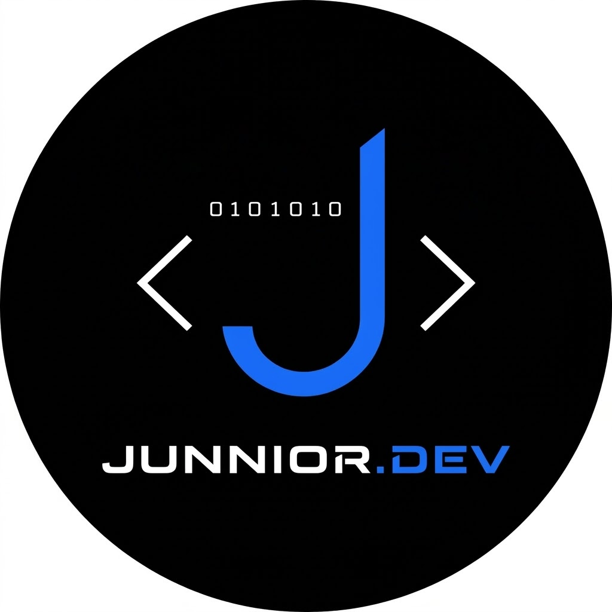

# Junnior.Dev

**Full Stack Developer · Ingeniero de Sistemas**
Desarrollo de software a medida (Web & Escritorio)

 

---

## Sobre mí

Diseño y construyo software que resuelve problemas concretos: sistemas de punto de venta, control de créditos y cobros, inventarios y plataformas web. Me enfoco en soluciones simples, mantenibles y listas para producción, sin dependencias innecesarias.

- Sistemas POS multi-tienda para comercios de Latinoamérica
- Aplicaciones para bodegas y pequeños negocios
- Herramientas de gestión para instituciones públicas
- Contenido educativo sobre programación en TikTok

> **¿Cotizamos tu proyecto?** Escríbeme por correo o por TikTok.

---

## Stack tecnológico

### Backend

### Frontend

### Escritorio

### Bases de datos

### Herramientas y despliegue

---

## Proyectos destacados

| Proyecto | Descripción | Tecnología |
|---|---|---|
| [**tiendapos-api**](https://github.com/belandriajunioremiro-ship-it/tiendapos-api) | API de punto de venta para comercios | PHP |
| [**sistema-de-fiados**](https://github.com/belandriajunioremiro-ship-it/sistema-de-fiados) | Control de fiados (créditos informales) con base de datos en la nube | HTML · CSS · JS · Supabase |
| [**AppCobros**](https://github.com/belandriajunioremiro-ship-it/AppCobros) | Aplicación para cobrar a clientes en bodegas y pequeños negocios | JavaScript |
| [**APPBODEGA**](https://github.com/belandriajunioremiro-ship-it/APPBODEGA) | Gestión de cobros para bodegas | JavaScript |
| [**posventabol**](https://github.com/belandriajunioremiro-ship-it/posventabol) | Sistema de posventa | Astro |
| [**paginaweb**](https://github.com/belandriajunioremiro-ship-it/paginaweb) | Sitio web | Astro |

---

## Estadísticas

---

## Contacto

*Software a la medida de tu negocio. Hablemos.*

