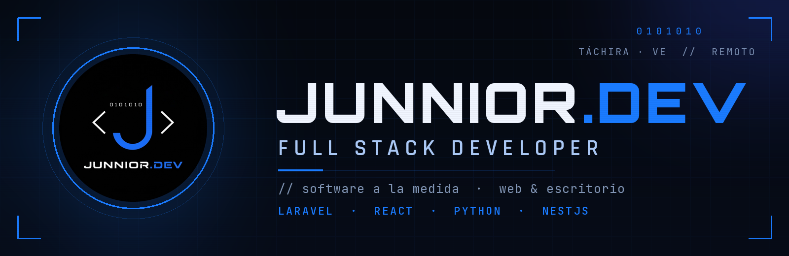
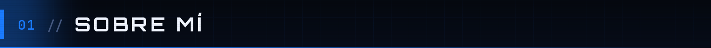
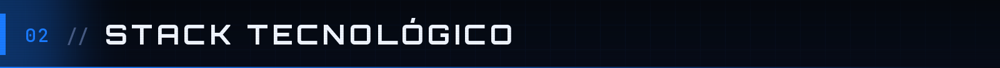
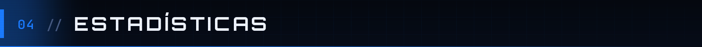

 

 

Diseño y construyo software que resuelve problemas concretos: **sistemas de punto de venta**, control de créditos y cobros, inventarios y plataformas web. Mi enfoque son las soluciones simples, mantenibles y listas para producción, sin dependencias innecesarias.

|  |  |
|---|---|
| **POS multi-tienda** | Sistemas para comercios de Latinoamérica: farmacias, ferreterías, licorerías, ropa y supermercados |
| **Negocios locales** | Aplicaciones de cobros y fiados para bodegas y pequeños negocios |
| **Sector público** | Herramientas de gestión para instituciones: inventario, catastro y control de asistencia |
| **Educación** | Contenido sobre programación en TikTok: Laravel, Python, Git y más |

> **¿Tienes un proyecto en mente?** Cotizamos sin compromiso. Escríbeme por correo o por TikTok.

 

**BACKEND**

**FRONTEND**

**ESCRITORIO**

**BASES DE DATOS**

**HERRAMIENTAS Y DESPLIEGUE**

 

 

 

  

