
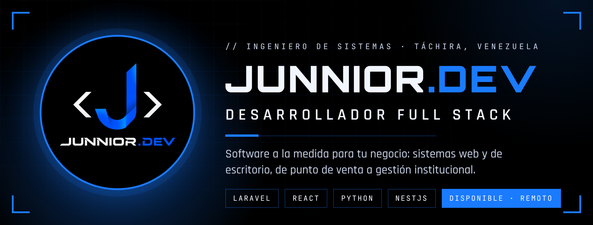

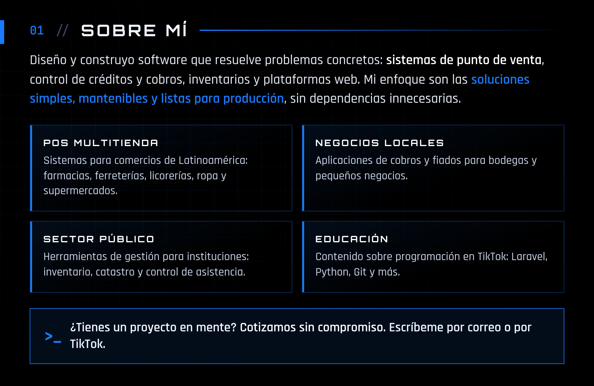

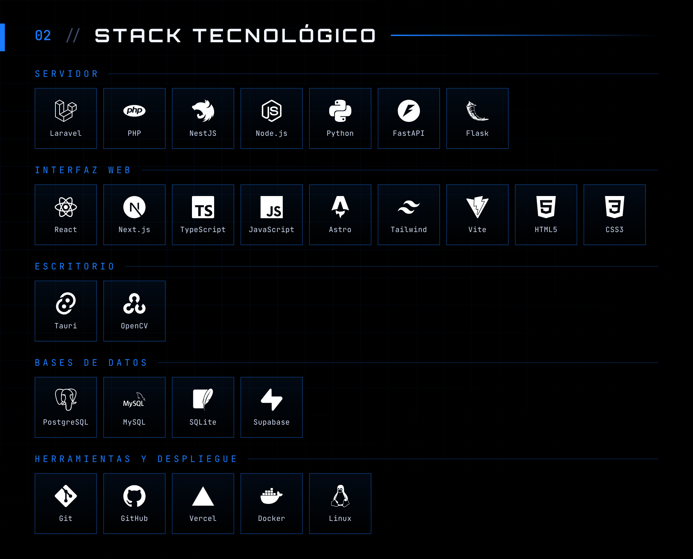

<a href="https://github.com/junnior-dev/tiendapos-api">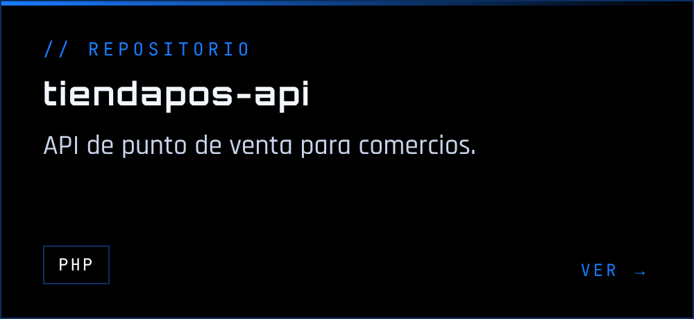</a><a href="https://github.com/junnior-dev/TiendaPos">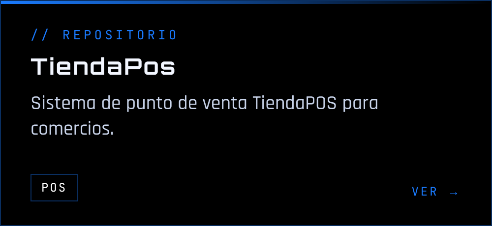</a><a href="https://github.com/junnior-dev/sistema-de-fiados">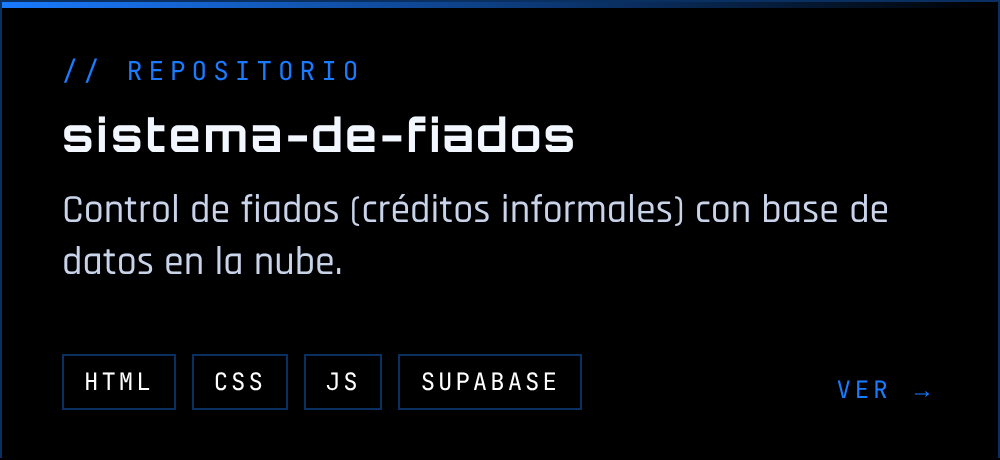</a><a href="https://github.com/junnior-dev/AppCobros">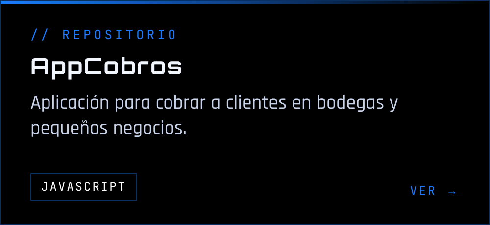</a><a href="https://github.com/junnior-dev/GeoCatastro">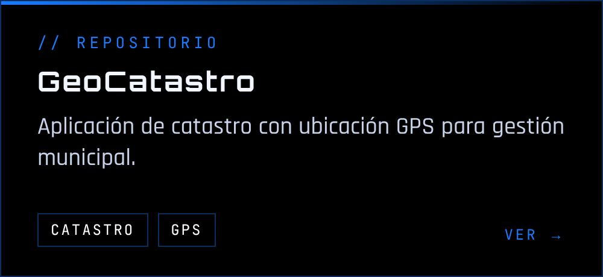</a><a href="https://github.com/junnior-dev/posventabol">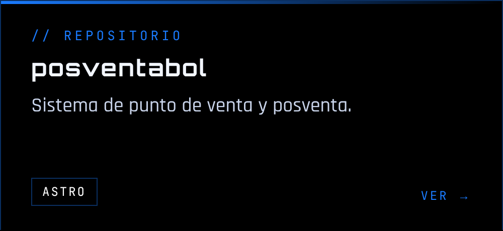</a>

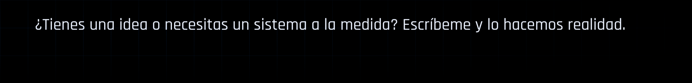

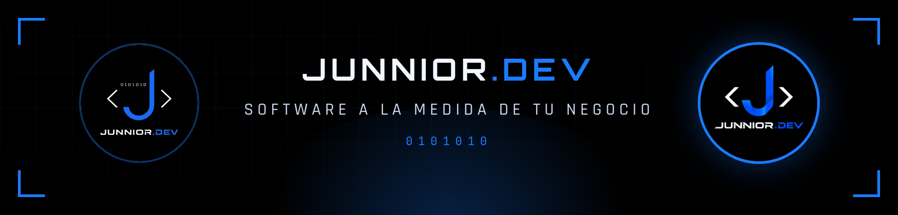

